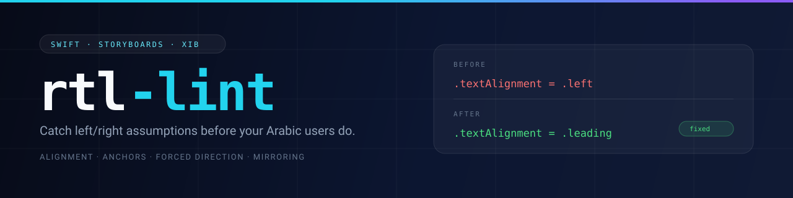

# rtl-lint

<p align="center">
  
</p>

<p align="center">
  <a href="https://github.com/hfip/rtl-lint/actions/workflows/ci.yml"></a>
  
  
  
  
</p>

<p align="center">
  <b>Shipping Arabic support is not the same as being RTL-ready.</b><br>
  <code>rtl-lint</code> finds the physical left/right assumptions that compile fine, look fine in
  English, and break the moment the app runs in Arabic.
</p>

---

## The bug class it catches

```swift
label.textAlignment = .left
label.leftAnchor.constraint(equalTo: view.leftAnchor).isActive = true
view.semanticContentAttribute = .forceLeftToRight
```

All three compile. All three look correct in an English build. In an Arabic build the
first two don't mirror at all, and the third silently disables mirroring for the whole
subtree — even though you added `ar.lproj` and translated every string.

```
Sources/ProfileView.swift
  9:20   error    RTL001  Physical alignment does not mirror in right-to-left layouts.  (fixable)
  10:22  error    RTL001  Physical alignment does not mirror in right-to-left layouts.  (fixable)
  14:20  error    RTL003  Left/right anchors and layout attributes are physical and never mirror.  (fixable)
  14:51  error    RTL003  Left/right anchors and layout attributes are physical and never mirror.  (fixable)
  15:47  warning  RTL005  Forcing a layout direction disables mirroring for this view.

5 issue(s) in 1 file(s) · 4 error(s) · 1 warning(s) · 4 auto-fixable, run rtl-lint --fix
```

## Rules

| Code | Severity | Catches | Auto-fix |
| --- | --- | --- | --- |
| `RTL001` | error | `textAlignment`, `contentHorizontalAlignment`, `alignment` set to `.left` / `.right` | `.leading` / `.trailing` |
| `RTL002` | error | `NSTextAlignment.left`, `UIControl.ContentHorizontalAlignment.right`, … | yes |
| `RTL003` | error | `leftAnchor`, `rightAnchor`, `leftMargin`, `NSLayoutConstraint.Attribute.left`, `attribute: .right` | yes |
| `RTL004` | warning | `UIEdgeInsets(top:left:bottom:right:)` | — |
| `RTL005` | warning | `.forceLeftToRight` / `.forceRightToLeft` | — |
| `RTL006` | warning | manual `userInterfaceLayoutDirection` branching | — |
| `RTL007` | warning | manual image mirroring with `CGAffineTransform(scaleX: -1)` | — |
| `RTL008` | warning | storyboard `textAlignment="left"` / `"right"` | — |
| `RTL009` | warning | storyboard `semanticContentAttribute="force…"` | — |

`--fix` only rewrites the mechanical cases (`RTL001`–`RTL003`). Directional decisions are
reported, never changed behind your back.

## Install

Requires Python 3.9+. No dependencies.

```bash
git clone https://github.com/hfip/rtl-lint.git
cd rtl-lint
pipx install .
```

## Usage

```bash
rtl-lint Sources/               # scan a folder
rtl-lint --fix Sources/         # apply safe fixes
rtl-lint --explain MyView.swift # include the reasoning for each finding
rtl-lint --format github .      # GitHub Actions annotations
rtl-lint --format json .        # machine readable
rtl-lint --list-rules           # full rule table
```

Exit codes: `0` clean, `1` issues found, `2` usage or config error.

## Suppressing a finding

```swift
// rtl-lint:ignore
label.textAlignment = .left

// rtl-lint:ignore RTL001,RTL003
label.leftAnchor.constraint(equalTo: view.leftAnchor).isActive = true
```

Use it for genuinely LTR-only content (code blocks, numeric tables, media controls).

## Configuration

`.rtllint.json`, discovered by walking up from the current directory (or passed with
`--config`):

```json
{
  "exclude": ["**/*+Generated.swift", "ThirdParty/**"],
  "ignore": ["RTL004"],
  "severity": { "RTL008": "error" }
}
```

`Pods/`, `Carthage/`, `.build/`, `DerivedData/` and `node_modules/` are always skipped.

## CI

One line, via the bundled composite action:

```yaml
- uses: actions/checkout@v4
- uses: hfip/rtl-lint@v1
  with:
    paths: Sources
```

Or run it yourself:

```yaml
- uses: actions/checkout@v4
- uses: actions/setup-python@v5
  with: { python-version: "3.12" }
- run: pip install git+https://github.com/hfip/rtl-lint
- run: rtl-lint --format github Sources/
```

Failures show up inline on the pull request diff, one annotation per finding.

## FAQ

**Does this replace testing in Arabic?**
No. It catches a specific, mechanical class of bugs that code review misses. Simulator
testing in Arabic is still how you catch truncation, Arabic typography and BiDi issues.

**Why not a SwiftLint rule?**
SwiftLint is excellent for per-file style rules. `rtl-lint` adds project-wide discovery,
exclusion logic, inline suppression for two codes at once, storyboard scanning and
`--fix` in one zero-dependency binary-less tool you can run from any CI.

**Does it report findings inside comments or string literals?**
No. Only real code is scanned: `//`, `/* */`, `"…"`, `"""…"""`, `#"…"#` and XML comments are
skipped, so `--fix` can never rewrite a log message or a test fixture.

**Will `--fix` break my layout?**
Only `RTL001`–`RTL003` are rewritten, and `.leading` / `.trailing` are the correct
equivalents on iOS 9+. Commit before running it and review the diff.

## بالعربي

<div dir="rtl" align="right">

التطبيق ما يصير جاهز للعربية بمجرد ما تضيف `ar.lproj` وتترجم النصوص. إذا استخدمت
`.left` أو `leftAnchor` أو `forceLeftToRight`، الواجهة ما تنعكس وتطلع مقلوبة أو
مزحّفة — والمشكلة ما تبان إلا لما تشغّل التطبيق بالعربي.

`rtl-lint` يفحص مشروع Xcode كامل، يمسك هذي الحالات، ويصلّح الآمن منها:

```bash
rtl-lint Sources/
rtl-lint --fix Sources/
```

ويشتغل داخل GitHub Actions ويعرض الملاحظات على سطور الـ PR مباشرة.

</div>

## License

[MIT](LICENSE) © 2026 Abdulluh.X
